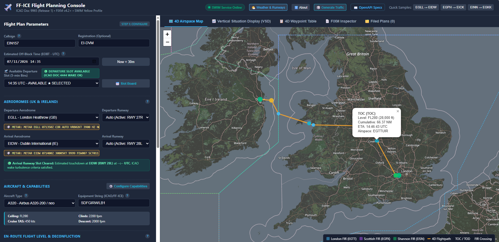
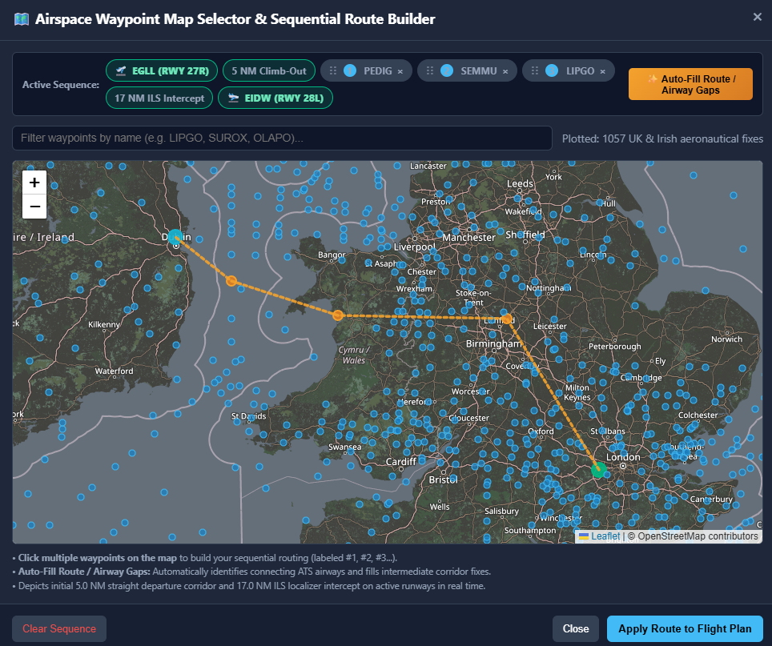
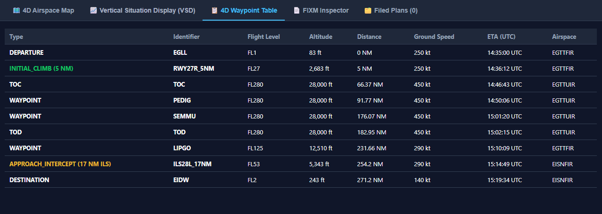
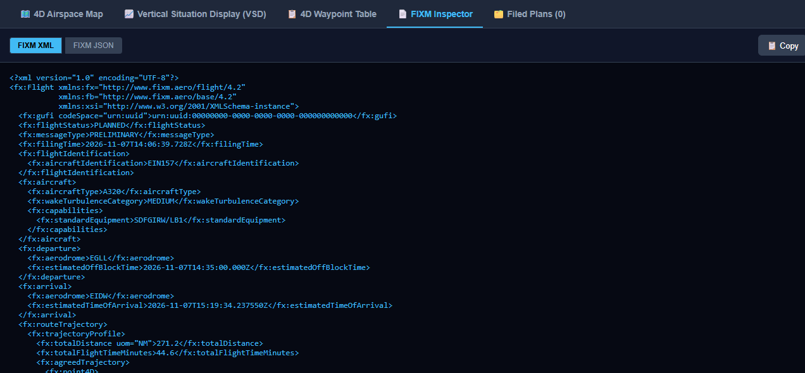
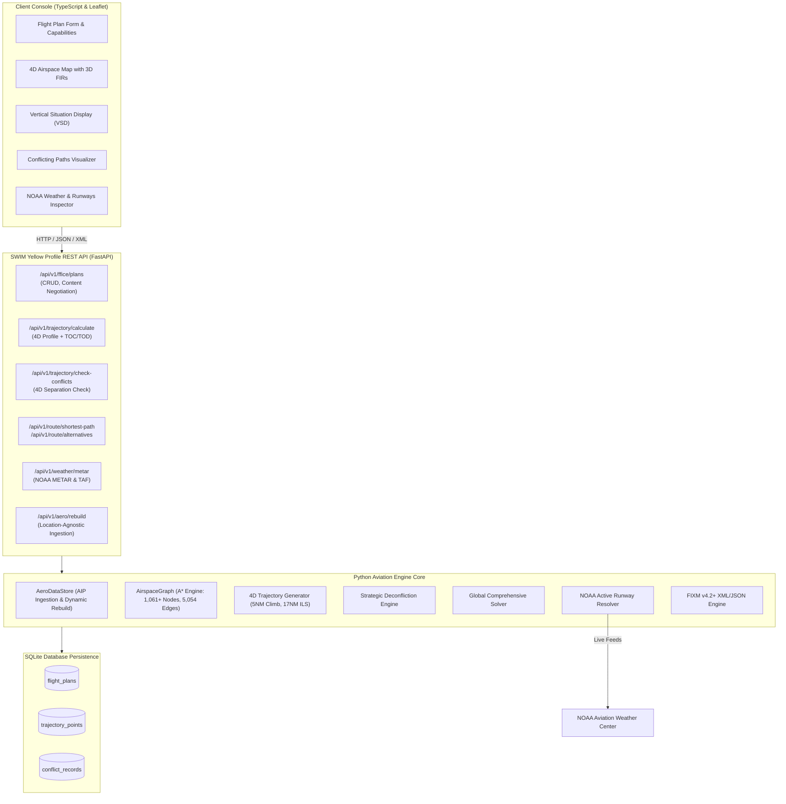

# FF-ICE & SWIM 4D Flight Planning Proof of Concept (PoC)

[](https://github.com/SDMCNS/FF-ICE_SWIM_POC)
[-blue.svg)](#proof-of-concept-disclaimer)
[](https://www.eurocontrol.int)
[](https://www.icao.int)
[](https://www.fixm.aero)
[](https://fastapi.tiangolo.com)
[](https://leafletjs.com)
[](https://aviationweather.gov)
[](#-test-suite--verification)

> **Repository:** [https://github.com/SDMCNS/FF-ICE_SWIM_POC](https://github.com/SDMCNS/FF-ICE_SWIM_POC)  
> **Tagline:** A proof of concept, open-source FF-ICE flight planning and 4D trajectory engine for collaborative, conflict-aware airspace operations.

---

> [!IMPORTANT]
> ### ⚠️ Proof of Concept (PoC) Notice
> This repository is an open-source **Proof of Concept (PoC)** and research reference implementation, certified, or production-grade Air Traffic Management (ATM) system. 
>
> Its purpose is to demonstrate the technical viability, architecture, and mathematical mechanics of:
> * **ICAO Doc 9965** (FF-ICE/R Release 1 Planning & Release 2 Execution)
> * **ICAO Doc 10039 / EUROCONTROL TI-Profile Yellow v2.0** (SWIM Web Services)
> * **FIXM Core v4.2+** XML and JSON dual-representation schemas
> * **ICAO Doc 9643** (Simultaneous Operations on Parallel Runways - SOIR)
> * Pre-departure 4D strategic deconfliction and multi-traffic optimization


---

## 📸 Application Interface & Component Visualizers

The interactive web console demonstrates real-time 4D trajectory negotiation, live NOAA weather observations, graphical airspace routing, and multi-traffic strategic deconfliction.

### 1. Main 4D Dispatch & Trajectory Console

*Interactive dispatch dashboard displaying flight plan parameters, live NOAA METAR weather badges, 4D trajectory profile on Leaflet GIS map with 3D FIR airspace boundaries, and real-time deconfliction advisory banner.*

---

### 2. Interactive Map Waypoint Selector & Airway Auto-Fill Modal

*Visual aeronautical chart allowing operators to select navigational fixes, inspect airway connections, reorder waypoint sequence via drag-and-drop handles, and auto-fill airway gaps using the topological graph engine.*

---

### 3. Vertical Situation Display (VSD Canvas)

*High-resolution vertical profile visualization depicting the 5.0 NM straight runway climb, dynamic Top of Climb (TOC), cruise level step-climbs, Top of Descent (TOD), regional FIR crossings, and the 17.0 NM stabilized $3^\circ$ ILS glideslope intercept.*

---

### 4. 4D Waypoint & Trajectory Point Sequence Table

*Complete chronological 4D waypoint sequence detailing point types, cumulative ground distance (NM), pressure altitude and flight levels, true airspeed/ground speed (knots), estimated overflight UTC timestamps, and jurisdictional FIR airspace sectors.*

---

### 5. Official FIXM v4.2+ XML Flight Plan Inspector & Export

*Full syntax-highlighted FIXM Core v4.2+ dual-namespace XML inspector with instant clipboard copying and file export capabilities ([`samples/fixm_flightplan.xml`](samples/fixm_flightplan.xml) and [`samples/fixm_flightplan.json`](samples/fixm_flightplan.json)).*

---

## 📚 Project Documentation Library

* 🚀 **[Platform Capabilities & Feature Matrix](docs/CAPABILITIES_AND_FEATURES.md):** Detailed technical breakdown of the 4D trajectory profile generator, global multi-traffic deconfliction, SOIR parallel concrete strips, EOBT vs ETOT timing, NOAA live weather resolver, and $A^*$ graph routing.
* 📖 **[Dispatcher & Operator User Guide](docs/USER_GUIDE.md):** Step-by-step visual manual covering route building, sequential map selection, conflict resolution, runway slotting, and plan filing.
* 📡 **[SWIM REST API Specification](docs/SWIM_API_SPECIFICATION.md):** Official RESTful interface documentation conforming to EUROCONTROL TI-Profile Yellow v2.0 and OpenAPI 3.0.
* 📜 **[SWIM Yellow Profile Compliance Audit](docs/SWIM_YELLOW_PROFILE_AUDIT.md):** Formal compliance scorecard comparing advertised service capabilities against runtime delivery requirements.

---

## 🏛️ System Architecture



---

## 🚀 Key Proof-of-Concept Capabilities

### 1. 4D Trajectory Generator & Realistic Runway Procedures
* **5 NM Straight Runway Climb:** Centers aircraft on runway heading for $5.0\text{ NM}$ straight climb (`RWY{rwy}_5NM`) up to $1,500\text{ ft AGL}$ with **no turning** post take-off (noise abatement).
* **17 NM ILS Localizer Intercept:** Intercepts destination localizer $17.0\text{ NM}$ out on active runway reciprocal heading (`ILS{rwy}_17NM`) at $5,400\text{ ft AGL}$ on a stabilized $3^\circ$ ILS glideslope.
* **TOC / TOD Physics:** Aircraft-specific climb/descent rate schedules (A320, B738, A321, B77W, A359, E190, AT76, DH8D, C172).
* **3D FIR Boundary Crossings:** Calculates exact spatial coordinates, crossing flight level, and UTC timestamps through regional FIR airspaces.

### 2. Location-Agnostic Data Ingestion & Rebuild API
* **Universal Dataset Parsing:** Scans any `.json`, `.txt`, or `.csv` placed in `airports/` and `Waypoints/` regardless of country code or naming scheme.
* **Dynamic Rebuild Endpoint:** Calling `POST /api/v1/aero/rebuild` hot-reloads all aerodromes, waypoints, and FIRs, regenerates the topological navigation mesh, and synthesizes runway operational modes on the fly.

### 3. Physical Concrete Strip Isolation & Multi-Parallel Runways (ICAO Doc 9643)
* **Concrete Strip Keying:** In parallel runway operations, arrivals and departures **do not use the same strip of concrete**. One strip handles departures (e.g. `27L` on `09R/27L`) and the other handles arrivals (e.g. `27R` on `09L/27R`). An arrival on the northern strip cannot create a false conflict for a departure on the southern strip.
* **Multi-Parallel Complexes:** Models multi-runway hubs like Paris Charles de Gaulle (`LFPG` quad parallel), Chicago O'Hare (`KORD`), Atlanta (`KATL`), and Amsterdam Schiphol (`EHAM`). Each complex dedicates outboard strips for arrivals and inboard strips for departures.
* **Single Runway Mixed-Mode:** Interleaves arrivals and departures on single strips (e.g. London Gatwick `EGKK 08R/26L`, Stansted `EGSS`) with runway occupancy buffers (75–90s) and wake vortex decay rules.

### 4. Multi-Traffic Global Comprehensive Deconfliction
* **Synchronous 4D Trajectory Temporal Interpolation:** Evaluates the exact simultaneous 3D coordinate vectors $\mathbf{x}(t)$ of all active traffic at every candidate trajectory timestamp $t$.
* **Vertical Separation Exemption Rule ($\ge 1,000\text{ ft}$):** Under ICAO RVSM rules, aircraft **can safely occupy the exact same horizontal position** if separated vertically by $\ge 1,000$ ft.
* **Phase-Dependent Horizontal Separation (When $\Delta z < 1,000\text{ ft}$):**
  * **En-Route Airspace:** $\Delta h \ge 5.0\text{ NM}$ required.
  * **Approach & ILS Intercept ($< 4,000\text{ ft}$):** $\Delta h \ge \max(3.0\text{ NM}, \mathcal{S}_{\text{wake}})$ required.
* **Simultaneous Multi-Flight Solving:** Computes single-click global solutions resolving all conflicts at once:
  * Vertical semicircular step-climbs ($\pm 2,000\text{ ft}$).
  * Longitudinal calibrated departure slot delays ($+5\text{ to }+30\text{ min}$).
  * Cruise speed control adjustments ($-30\text{ kt}$).
  * Dynamic lateral graph corridor bypasses around congested fixes.

### 5. Central GUFI Registry Demonstration Service
* Demonstration node for ICAO Doc 9965 Central Register principles.
* Centrally coordinates and allocates authoritative GUFIs (`/api/v1/registry/gufi/allocate`) with anti-collision guarantees across distributed clients prior to global SWIM federation.

---

## 🛠️ Quick Start

### 1. Requirements
* Python 3.10+ (FastAPI, Uvicorn, SQLAlchemy, Shapely)
* Node.js v18+ (for TypeScript unit tests and bundling)

### 2. Start the SWIM Server & SQLite Database
```bash
python -m uvicorn ff_ice_server.main:app --host 127.0.0.1 --port 3000 --reload
```
Open **[http://127.0.0.1:3000](http://127.0.0.1:3000)** in your browser to launch the interactive planning console.

### 3. Populate Database with Realistic Commercial Air Traffic
```bash
python scripts/generate_traffic.py --count 25 --hours 6
```
Or use the **`[🎲 Generate Traffic]`** button in the console navigation header.

---

## 📡 REST API Reference Summary

| Endpoint | Method | Description |
|---|---|---|
| `/api/v1/trajectory/calculate` | `POST` | Calculates 4D trajectory, TOC/TOD, FIR crossings, and deconfliction preview. |
| `/api/v1/ffice/plans` | `POST` | Files an FF-ICE plan (supports FIXM XML/JSON content negotiation). |
| `/api/v1/ffice/plans/{gufi}` | `GET` | Retrieves plan by GUFI (`application/json` or `application/vnd.fixm+xml`). |
| `/api/v1/conflicts` | `GET` | Lists active 4D separation loss records from the database. |
| `/api/v1/airports/{icao}/slots` | `GET` | Retrieves 5-minute runway slot capacity bins and availability schedule. |
| `/api/v1/airports/{icao}/slots/next-available` | `GET` | Finds the nearest conflict-free runway slot after a requested time. |
| `/api/v1/airports/{icao}/runways` | `GET` | Retrieves physical concrete strips and segregated operational roles. |
| `/api/v1/aero/rebuild` | `POST` | Dynamically rebuilds all aeronautical datasets and navigation mesh from disk. |
| `/api/v1/weather/metar` | `GET` | Fetches live NOAA METAR, TAF, and active runway vectors for any ICAO aerodrome. |
| `/api/v1/route/autofill` | `POST` | Intelligently auto-fills route waypoint gaps and connects ATS airways. |
| `/api/v1/route/shortest-path` | `POST` | Computes $A^*$ shortest airway path across the aeronautical graph. |
| `/api/v1/route/alternatives` | `POST` | Generates $K$-alternative lateral corridors with distance deltas. |
| `/api/v1/waypoints/{name}/alternates`| `GET` | Returns dynamic topological detour alternates for any waypoint. |
| `/api/v1/config/metadata` | `GET` | Returns status and counts of loaded JSON configuration files. |
| `/api/v1/config/aircraft` | `GET` | Returns all active aircraft aerodynamic performance profiles. |
| `/api/v1/config/aircraft` | `POST` | Dynamically adds or updates an aircraft profile into custom overrides. |
| `/api/v1/config/wake-rules` | `GET` | Retrieves departure intervals and approach separation matrices. |
| `/api/v1/config/reload` | `POST` | Immediately hot-reloads all JSON configurations from the `config/` directory. |
| `/api/v1/registry/gufi/allocate` | `POST` | Centrally allocates an authoritative GUFI (ICAO Doc 9965 Central Register placeholder). |
| `/api/v1/registry/gufi/{gufi}/verify` | `GET` | Verifies GUFI registration with Central Registry authority. |
| `/api/v1/registry/gufi` | `GET` | Lists centrally tracked GUFIs and lifecycle statuses (`ALLOCATED`, `COMMITTED`, `CANCELLED`). |
| `/api/v1/swim/service-description` | `GET` | Delivers official Yellow Profile Service Description Document (SDD). |
| `/api/v1/swim/health` | `GET` | Standardized SWIM Yellow Profile liveness and database status. |
| `/api/v1/swim/status` | `GET` | Operational capacity, active plans, and supported runway operational modes. |

---

## 🧪 Test Suite & Verification

All 56 Python tests and 4 Node.js phases pass with 100% success:

```bash
# Run complete Python test suite (56 tests)
pytest tests

# Run TypeScript Master Test Suite (Phases 1 - 4)
npm test
```

---

## 📜 Standards & References
- **ICAO Doc 9965**: Manual on Flight and Flow Information for a Collaborative Environment (FF-ICE/R).
- **ICAO Doc 10039**: Manual on System-Wide Information Management (SWIM) Concept.
- **ICAO Doc 9643**: Manual on Simultaneous Operations on Parallel or Near-Parallel Instrument Runways (SOIR).
- **ICAO Doc 4444**: Procedures for Air Navigation Services - Air Traffic Management (PANS-ATM).
- **EUROCONTROL TI-Profile Yellow**: Technical Infrastructure Yellow Profile v2.0 (REST/Web Services).
- **RFC 7807**: Problem Details for HTTP APIs.
- **FIXM Core v4.2 / v4.3**: [https://www.fixm.aero](https://www.fixm.aero)
- **NOAA Aviation Weather Center**: [https://aviationweather.gov](https://aviationweather.gov)
- **GitHub Repository**: [https://github.com/SDMCNS/FF-ICE_SWIM_POC](https://github.com/SDMCNS/FF-ICE_SWIM_POC)
