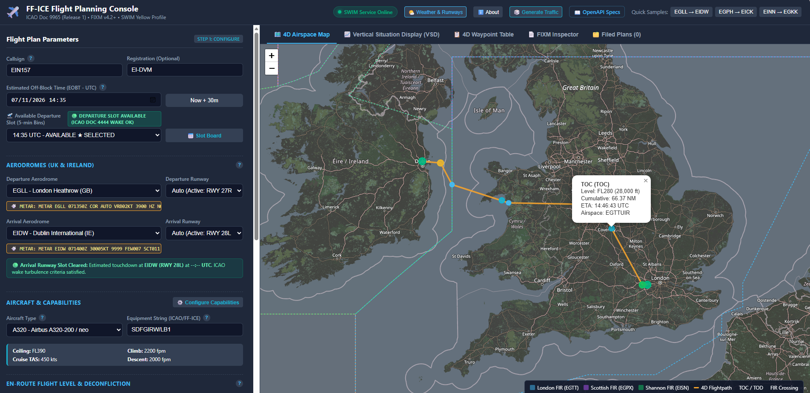
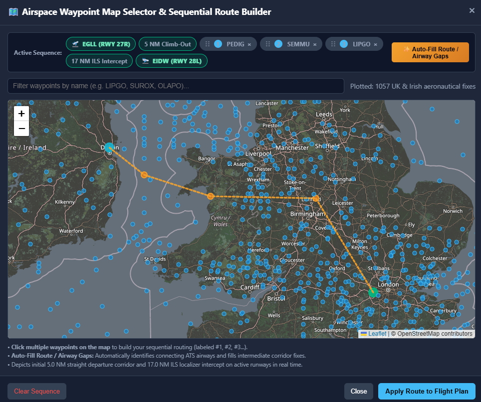
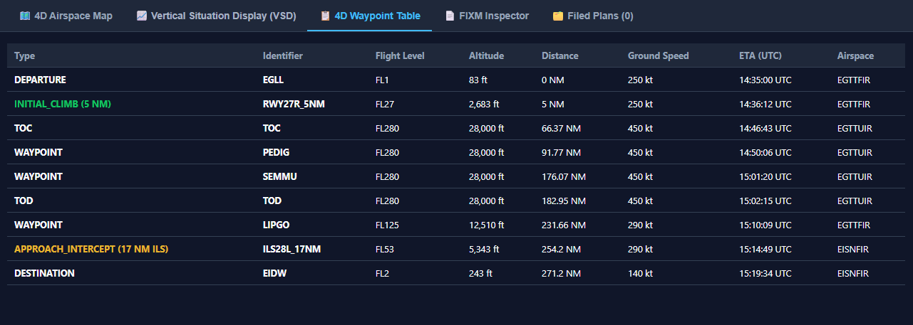
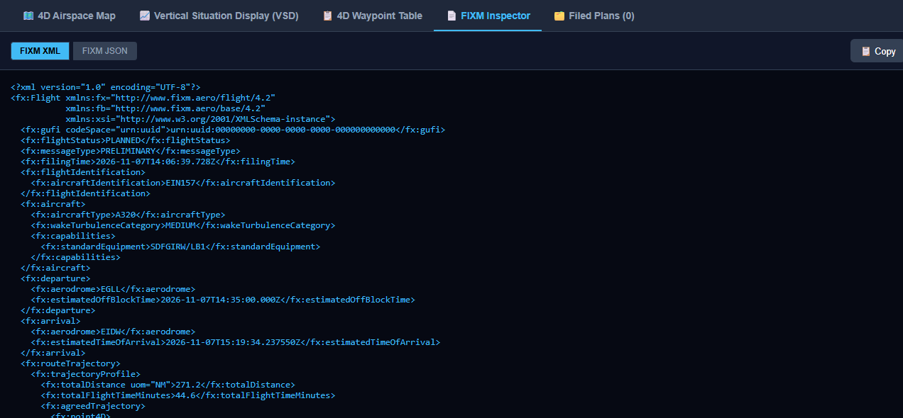

# FF-ICE & SWIM Proof of Concept (PoC) Dispatcher & Operator User Guide
## Interactive Manual for 4D Flight Planning, Airspace Deconfliction, and Airport Slot Management

> **Repository:** [SDMCNS/FF-ICE_SWIM_POC](https://github.com/SDMCNS/FF-ICE_SWIM_POC)  
> **Notice:** Open-Source Proof of Concept (PoC) for research and evaluation.  
> **Target Audience:** Flight Dispatchers, Commercial Pilots, Aviation Researchers, and Software Engineers.  
> **Interface:** Interactive Web Dispatch Console (`http://localhost:3000`).  

---

## 1. Quick Start Workflow

The dispatch console simplifies complex 4D trajectory negotiation into a straightforward 5-step operational workflow:

```
  1. Set Ident & Timing    2. Select Aerodromes     3. Build Waypoints      4. Deconflict 4D Path    5. File FF-ICE Plan
 ┌──────────────────────┐ ┌──────────────────────┐ ┌──────────────────────┐ ┌──────────────────────┐ ┌──────────────────────┐
 │ Callsign: EIN157     │ │ Dep: EGLL (RWY 27R)  │ │ Add: LUXTO, PEPZE,   │ │ View Trajectory &    │ │ Submit via SWIM      │
 │ Aircraft: A320       │ │ Arr: EIDW (RWY 28L)  │ │      SUROX, LIPGO    │ │ Conflicts; Apply Top │ │ Receive Authoritative│
 │ EOBT: 16:00 UTC      │ │ Auto-NOAA Active RWY │ │ Interactive Drag/Map │ │ Global Solution      │ │ Central GUFI UUID    │
 └──────────────────────┘ └──────────────────────┘ └──────────────────────┘ └──────────────────────┘ └──────────────────────┘
```

---

## 2. Dispatch Console Overview



The primary console is divided into two operational panels:
* **Left Panel (Flight Plan & Dispatch Controls):** Callsign, off-block timing (`EOBT`), departure/arrival aerodrome selectors, dynamic weather badges, aircraft performance profiles, avionics capability checkboxes, 4D strategic deconfliction advisories, and sequenced waypoint chips.
* **Right Panel (Visual Situation Display & Data Feeds):** High-definition 4D Airspace Map with 3D FIR airspace boundaries, interactive Vertical Situation Display (VSD), 4D Trajectory Waypoint sequence table, and raw FIXM XML/JSON viewers.

---

## 3. Detailed Operational Procedures

### 3.1 Timing & Aerodrome Selection
1. **Aircraft Identification (Callsign):** Enter the operational telephony callsign (e.g. `EIN157`, `BAW826`, `RYR204`).
2. **Estimated Off-Block Time (EOBT) & Take-Off Time (ETOT):**
   * Enter the intended off-stand pushback time in UTC.
   * Note the dynamic **Runway Timing Ribbon** directly beneath the input: it computes estimated wheels-off time (`ETOT = EOBT + EXOT`), displaying the aerodrome's taxi-out time (e.g., 20 min for Heathrow `EGLL`, 15 min for Dublin `EIDW`).
   * The ribbon highlights the aerodrome's operational runway mode (e.g. `PARALLEL_SEGREGATED` vs `MIXED_MODE_SINGLE`).
3. **Aerodromes & Dynamic Runway Selection:**
   * Select the departure and arrival aerodromes.
   * The system immediately queries the **NOAA Aviation Weather Center** for real-time METAR observations and wind conditions, automatically selecting the active runway heading into the prevailing wind.
   * If desired, manually select a specific runway from the dropdown.

---

### 3.2 Sequential Waypoint Building & Map Selection



1. **Adding Waypoints:**
   * Type a waypoint code (e.g. `LIPGO`, `SUROX`, `OLAPO`) into the search field and click **`+ Add Waypoint`**.
   * Or click an **ATS Airway Preset** (`L18`, `L149`, `L975`) to instantly load standard airway segments.
2. **Interactive Aeronautical Chart Selection (`🗺️ Select on Map`):**
   * Click **`🗺️ Select on Map`** to launch the full-screen Waypoint Selector Modal.
   * Navigational fixes are rendered as purple diamonds, with departure and arrival aerodromes highlighted in green and blue.
   * Click any fix on the map to add it to your flight sequence.
3. **Drag-and-Drop Waypoint Reordering:**
   * In both the main console and the map modal, grab any waypoint chip's drag handle (`⋮⋮`) to reorder the flight sequence.
4. **Intelligent Airway Gap Auto-Fill (`✨ Auto-Fill Route / Airway Gaps`):**
   * Click the auto-fill button to let the topological graph engine automatically detect gap intervals and splice in necessary intermediate ATS airway fixes.
5. Click **`Apply Route to Plan`** to commit the route and immediately calculate the 4D trajectory.

---

### 3.3 Trajectory Profile & Vertical Situation Display (VSD)


Upon clicking **`🚀 Calculate 4D Trajectory`**, the platform renders:
* **5 NM Straight Climbout:** Aircraft heading locked to runway centerline until $5.0\text{ NM}$ out (`RWY{rwy}_5NM`) up to $1,500\text{ ft AGL}$.
* **Top of Climb (TOC):** Exact spatial point where the aircraft reaches cruise flight level.
* **Top of Descent (TOD):** Calculated point of initial descent based on aircraft descent rates.
* **FIR Boundary Crossings:** Highlighted crossing fixes where the aircraft enters and exits regional FIRs (`EGTT`, `EGPX`, `EISN`, `EGGX`).
* **17 NM ILS Intercept:** Intercept fix (`ILS{rwy}_17NM`) aligning aircraft with the $3^\circ$ ILS localizer glideslope at $5,400\text{ ft AGL}$.



The **4D Waypoint Table** tab lists every point in chronological order, displaying:
* Point Type (`DEPARTURE`, `WAYPOINT`, `TOC`, `TOD`, `FIR_CROSSING`, `ILS_INTERCEPT`, `DESTINATION`).
* Altitude (ft) and Flight Level (FL).
* Cumulative Ground Distance (NM).
* Ground Speed (knots) and UTC Estimated Overflight Time.
* Associated FIR / UIR Airspace sector.

---

### 3.4 4D Strategic Deconfliction & Conflict Resolution

If the candidate trajectory conflicts with active traffic in the database (violating 5.0 NM horizontal, 1,000 ft vertical, or runway wake intervals):
1. **Deconfliction Banner:** Displays an alert detailing the number of conflicting flights and diagnostic parameters.
2. **Global Comprehensive Solutions:**
   * The solver recommends high-efficiency system-wide resolutions (e.g. *Cruise Step Climb to FL300 [98% Efficiency]*, *Departure Slot Delay +10m*, or *Mach Speed Adjustment*).
   * Click **`⚡ Apply Comprehensive Solution`** to instantly adjust your flight parameters and achieve clear separation with a single click.
3. **Tactical Conflict Map Visualizer (`🗺️ View All Conflicting Paths on Map`):**
   * Opens the multi-traffic conflict visualizer, rendering the candidate flight path (thick amber polyline) alongside all conflicting traffic paths (dashed colored polylines).
   * Pulsing red CPA (Closest Point of Approach) radar markers highlight the exact predicted point of loss of separation.
   * Click **`🎯 Zoom to CPA`** to center the map on the conflict point.

---

### 3.5 Airport Runway Slot Management Board (`📅 Slot Board`)
1. Click **`📅 Slot Board`** to open the 5-minute runway capacity scheduling matrix for your aerodrome.
2. The board displays:
   * Total slots, available slots, and occupied slots.
   * **Runway Operational Mode Banner:** Explains whether the airport is operating in independent parallel mode (`PARALLEL_SEGREGATED`, e.g. EGLL, EIDW) or single-runway mixed mode (`MIXED_MODE_SINGLE`, e.g. EGKK, EGSS).
   * Individual 5-minute slot cards displaying **Wheels-Off Time (`ETOT`)**, **Gate Pushback Time (`EOBT`)**, and booking flight callsigns.
3. Click any green **AVAILABLE** slot to automatically schedule your flight into that slot window.

---

### 3.6 Aerodrome Weather & Operational Runway Inspector (`🌤️ Aerodrome Weather`)
1. Click **`🌤️ Weather & Runways`** in the navigation header or click any aerodrome weather badge.
2. View real-time **NOAA METAR** text, decoded flight category (VFR/IFR), QNH altimeter setting, surface wind, and temperature.
3. Review the **Runway Wind Vector Table**, which calculates headwind, tailwind, and crosswind velocity for every runway strip.
4. Use quick-action buttons to set the aerodrome as your departure or arrival airport with one click.

---

### 3.7 Plan Filing, Verification, and Export



1. **Strict SWIM Enforcement Toggle:** Enable the **Strict SWIM Mode** checkbox if you wish the server to reject the plan if any separation conflict exists (`409 Conflict`).
2. **File Flight Plan (`✈️ File FF-ICE Flight Plan`):**
   * Submits the plan to the SWIM server via `POST /api/v1/ffice/plans`.
   * Automatically allocates and commits an authoritative **Central GUFI** (`urn:uuid:...`).
   * Persists trajectory points to SQLite for real-time deconfliction against future traffic.
3. **Export Formats:**
   * Click **`💾 Export FIXM XML`** to download standard ICAO FIXM v4.2+ XML (`fixm_flightplan.xml`).
   * Click **`💾 Export FIXM JSON`** to download standard JSON representation (`fixm_flightplan.json`).
   * Click **`📋 Copy Payload`** to copy the raw payload directly to your clipboard.
4. **Filing Table & Cancellation:**
   * View all active flights in the **Active & Filed Plans** tab.
   * Click **`Cancel`** beside any plan to issue an official SWIM cancellation, which releases the central GUFI and removes the aircraft from active airspace deconfliction queues.

